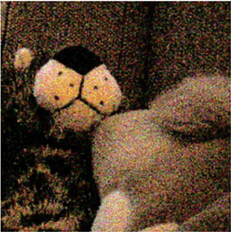
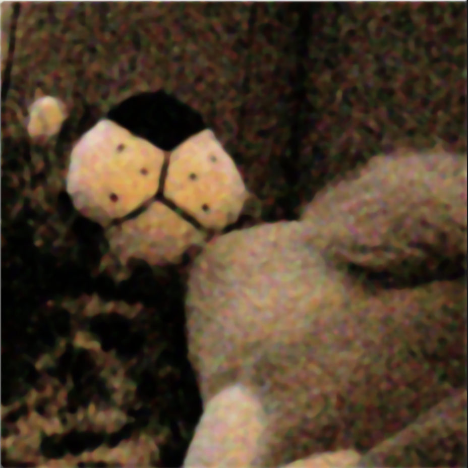

# ЛР1. Медианный фильтр с переменным размером ядра

**Вариант 4**

## Цель работы

Научиться реализовывать один из алгоритмов обработки изображений: медианный фильтр.  
Реализованы два варианта: библиотечный (OpenCV) и нативный (собственная реализация на Python). Выполнено сравнение быстродействия.

---

## 1. Теоретическая база

Медианный фильтр — нелинейный фильтр сглаживания. Для каждого пикселя берётся окрестность размера k (ядро), значения в окне сортируются, и в результат записывается **медиана** (средний элемент отсортированного списка).

- Размер ядра \(k\) должен быть **нечётным** (\(3, 5, 7 и тд.)), чтобы у окна была однозначная «середина».
- Чем больше \(k\), тем сильнее подавляется шум, но тем сильнее сглаживание мелких деталей и тем выше вычислительная стоимость.
- Медианный фильтр особенно эффективен против импульсного шума («соль и перец»): выбросы уходят на края отсортированного списка и редко становятся медианой.
- В отличие от усредняющего (линейного) фильтра, медиана лучше сохраняет резкие границы объектов.

Для цветного изображения фильтр обычно применяется **независимо к каждому каналу** (B, G, R).

На границе изображения полной окрестности нет. В работе используется **clamp** (повторение крайнего пикселя): координаты соседей ограничиваются пределами кадра.

---

## 2. Описание разработанной системы

### Архитектура

Программа представляет собой Python-приложение:

1. Пользователь вводит путь к изображению и нечётный размер ядра \(k\).
2. Запускается библиотечная реализация на OpenCV.
3. Запускается нативная реализация.
4. Сохраняются результаты и выводится время работы обоих вариантов.

### Библиотечный алгоритм

Используется встроенная функция OpenCV:

- `cv2.imread` — загрузка изображения;
- `cv2.medianBlur(img, k)` — медианный фильтр;
- `cv2.imwrite` — сохранение результата в `opencv_median.png`.

### Нативный алгоритм

Реализован вручную без готовой функции медианного фильтра:

1. Загрузить изображение.
2. Для каждого пикселя \((y, x)\) и каждого канала:
   - собрать окно \(k) вокруг пикселя;
   - у границы координаты ограничить (`min` / `max`);
   - отсортировать список значений;
   - взять элемент с индексом `len // 2` (медиану);
   - записать в выходное изображение.
3. Сохранить результат в `mine_median.png`.

Чтение идёт из исходного буфера, запись — в копию, чтобы уже обработанные пиксели не влияли на соседей.

### Основные функции

| Функция | Назначение |
|---------|------------|
| `median_filter_biblio` | фильтр через OpenCV |
| `median_filter_mine` | собственная реализация |
| `median_of_list` | медиана списка (сортировка + средний элемент) |

## 3. Результаты работы и тестирования системы

### 3.1. Тестовые данные

Основной тест — изображение с сильным импульсным (зернистым) шумом: `input2.png` (плюшевая игрушка).  
Такой шум — типичный сценарий для медианного фильтра: выбросы уходят на края отсортированного окна и не становятся медианой.

### 3.2. Визуальные результаты (основной тест)

Параметр: **k = 7**.

| Исходное (шум) | OpenCV `medianBlur` | Нативная реализация |
|----------------|---------------------|---------------------|
|  |  |  |

**Наблюдения:**
- цветная «сыпь» на морде и фоне заметно ослабевает;
- крупные границы (нос, контур морды) сохраняются лучше, чем при обычном усреднении;
- результаты OpenCV и своей реализации визуально близки — значит, нативный алгоритм реализован корректно;
- тонкая текстура меха сглаживается (ожидаемый побочный эффект медианы).

### 3.3. Влияние размера ядра k

Один и тот же кадр, разные `k` (удобно показать рядом скрины OpenCV):

| k | Эффект |
|---|--------|
| **3** | шум ослаблен слабо/средне, детали и текстура меха сохраняются лучше |
| **5** | хороший баланс: шум сильно подавлен, структура морды ещё читается |
| **7** | шум почти убран, но появляется «живописное» мыло, мелкие точки/детали пропадают |

**Закономерность:** чем больше `k`, тем сильнее подавление импульсного шума и тем сильнее потеря мелких деталей и рост времени работы.

### 3.4. Сравнение быстродействия

Замеры: `time.perf_counter()`, одно и то же изображение и одно `k`.  

| Реализация | k | Время, с | Во сколько раз медленнее OpenCV |
|------------|---|----------|----------------------------------|
| OpenCV (`cv2.medianBlur`) | 7 | 0.035 | 1× |
| Нативная (Python, циклы + `sorted`) | 7 | 18.474 | 527.828× |

Пример для второго замера (чтобы показать рост с `k`):

| Реализация | k = 3 | k = 5 |
|------------|-------|-------|
| OpenCV | 0.039 | 0.035 |
| Нативная | 3.450 | 9.313 |

**Закономерности по времени:**
1. Нативная версия существенно медленнее: чистый Python и сортировка окна `k×k` на каждом пикселе и канале.
2. OpenCV написан на оптимизированном C/C++ и работает на порядки быстрее.
3. При увеличении `k` время нативной реализации растёт примерно как \(O(k^2 \log k)\) на пиксель.

### 3.5. Корректность

- На шумном кадре оба метода дают сходный визуальный результат при одинаковом `k`.
- Краевые пиксели обрабатываются через clamp (повторение края) — артефактов «пустой рамки» нет.
- `k` принимается только нечётным, что соответствует определению медианы для окна нечётного размера.

---

## 4. Выводы по работе

1. Реализован медианный фильтр с переменным размером ядра в двух вариантах: библиотечном (OpenCV) и нативном (Python).
2. На изображениях с импульсным/зернистым шумом (`input2`) фильтр заметно очищает кадр и при умеренном `k` сохраняет крупные границы объектов.
3. Оптимальный компромисс качества для таких кадров — обычно **k = 5**; `k = 3` слабее чистит шум, `k = 7` сильнее «замыливает» детали.
4. Сравнение быстродействия показало большое преимущество OpenCV над наивной Python-реализацией при близком визуальном результате.

---

## 5. Использованные источники

1. Гонсалес Р. С., Вудс Р. Э. Цифровая обработка изображений.
2. OpenCV Documentation. Image Filtering — Median Blur:  
   https://docs.opencv.org/4.x/d4/d86/group__imgproc__filter.html#ga564869aa33e58769b4469101bbc45832
